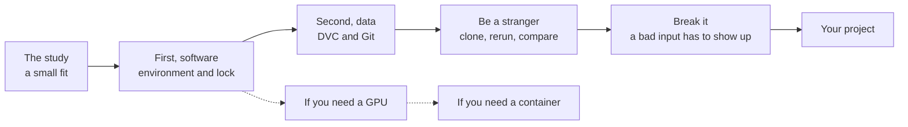

# Reproducibility in AI

**Software, data, and research practice.** The hands-on companion to the workshop at Rice Research Computing Day, November 10, 2026.

Dr. Christopher S. Simmons, Scientist-in-Residence, Cambridge Computer

> "Bringing cloud-native, declarative, and stateless concepts to batch HPC workloads solves most problems" – Me, now

99+% of papers that involve computation are by definition not reproducible, and therefore they aren't really Science. The tools to fix most of that already exist, they're free, and they aren't hard. If you're waiting for a sysadmin, you're not doing science in 2026.

A three-hour workshop doesn't leave time to do this together, so do it here, at your own pace. You'll run a small study, record it properly, rerun it as a stranger, and break it on purpose. Then you'll do the same to your own project.

Read this page top to bottom. It's written as a literate program in Donald Knuth's sense: the explanation and the method are one document, in the order a person needs them. Every script in this repository is generated from the code on this page ([how](#appendix-how-this-page-works)).

## What you'll do



| Part | You'll learn | You need |
|---|---|---|
| [The study](#the-study) and [first, software](#first-software) | An environment anyone can rebuild | conda, git |
| [Second, data](#second-data) | Data and results that can be restored and compared | The same |
| [Be a stranger](#be-a-stranger) and [break it](#break-it-on-purpose) | Whether your work really reruns, and whether your check can fail | The same |
| [If you need a GPU](#if-you-need-a-gpu) | A GPU stack you can prove works | An NVIDIA GPU |
| [If you need a container](#if-you-need-a-container) | The same stack, portable to the next system | Docker and Apptainer |
| [Third, LLM work](#third-llm-work) | How to keep your method out of the chat | Nothing to install |
| [On your own project](#on-your-own-project) | What to do first | Your project |

The study and the data parts run on Linux or macOS, or on Windows through WSL, on x86_64 or ARM. No GPU, no cluster, and no root access are needed.

## Before you start

You need `git` and conda. If you don't have conda, install Miniforge. It goes in your home directory, so you don't need root, and this picks the right build for your machine:

```bash
curl -fsSLO "https://github.com/conda-forge/miniforge/releases/latest/download/Miniforge3-$(uname)-$(uname -m).sh"
bash "Miniforge3-$(uname)-$(uname -m).sh" -b -p "$HOME/miniforge3"
source "$HOME/miniforge3/bin/activate"
```

Get this repository:

```bash
git clone https://github.com/ohpcsim/reproducibility-in-ai.git ~/reproducibility-in-ai
cd ~/reproducibility-in-ai
```

You're going to commit, so Git needs your name. These print what it has now. If either is empty, set it, for example with `git config --global user.name "Your Name"`.

```bash
git config --global user.name
git config --global user.email
```

> [!TIP]
> If you come back in a new terminal, run `source ~/miniforge3/bin/activate`, then `conda activate` the environment you were using, and `cd` back to where you were. On a Mac, the code blocks are safe to paste into the default zsh.

## The study

Here's the science, small on purpose so you can see all of it. **Does `y` follow a straight line in `x`, and how well does a fit on one set of data predict data it hasn't seen?**

The data is synthetic, and the script records where it came from and the seed it used. Real data would come with the same kind of note.

```python
# file: study/scripts/make_data.py
"""Generate the synthetic dataset for this study.

Provenance: synthetic, y = 2.5 * x + 1.0 + noise, seed 20261110.
Run once; the outputs are tracked by DVC, not Git.
"""
import csv
import pathlib
import random

rng = random.Random(20261110)
for split, n in (("train", 80), ("val", 20)):
    out = pathlib.Path("data", split)
    out.mkdir(parents=True, exist_ok=True)
    with open(out / "data.csv", "w", newline="") as f:
        w = csv.writer(f)
        w.writerow(["x", "y"])
        for _ in range(n):
            x = rng.uniform(0, 10)
            w.writerow([f"{x:.6f}", f"{2.5 * x + 1.0 + rng.gauss(0, 0.5):.6f}"])
```

The analysis fits on the training data, scores on the validation data, and writes down what happened.

```python
# file: study/train.py
"""Fit y = a*x + b by least squares on data/train, score RMSE on data/val."""
<<train imports>>


<<load a split>>


<<fit and score>>

<<write the model and the metrics>>
```

```python
# <<train imports>>=
import csv
import json
import pathlib

import numpy as np
```

```python
# <<load a split>>=
def load(split):
    with open(pathlib.Path("data", split, "data.csv")) as f:
        rows = list(csv.DictReader(f))
    return np.array([float(r["x"]) for r in rows]), np.array([float(r["y"]) for r in rows])
```

```python
# <<fit and score>>=
x, y = load("train")
a, b = np.polyfit(x, y, 1)
xv, yv = load("val")
rmse = float(np.sqrt(np.mean((a * xv + b - yv) ** 2)))
```

`metrics.json` is small, so it goes in Git. That's what lets someone compare their result with yours later.

```python
# <<write the model and the metrics>>=
pathlib.Path("model").mkdir(exist_ok=True)
pathlib.Path("model/model.json").write_text(json.dumps({"a": round(float(a), 6), "b": round(float(b), 6)}, indent=2) + "\n")
pathlib.Path("metrics.json").write_text(json.dumps({"val_rmse": round(rmse, 6), "a": round(float(a), 6), "b": round(float(b), 6)}, indent=2) + "\n")
```

## First, software

Start every environment from a file, never from the command line, and keep that file in Git next to the science. Unless you must, try to avoid specifying the versions of each package. Pin only what your science needs, as this file does with major versions, and let the lock record the rest.

```yaml
# file: study/environment.yml
name: repro-dvc
channels:
  - conda-forge
dependencies:
  - python=3.12
  - numpy=2
  - dvc=3
```

That file says what you asked for. The lock file says what you got: every package, build, and hash. A lock belongs to one platform, so yours will differ from your colleague's if they're on a different machine, and each platform gets its own. Make a working copy of the study so the repository stays clean, build the environment, and record it.

<!-- <<build the environment>>= -->
```bash
mkdir -p ~/repro-demo && cp -r study ~/repro-demo/ && cd ~/repro-demo/study
conda env create -f environment.yml
conda activate repro-dvc
conda list -n repro-dvc --explicit --md5 > lock.txt
grep -E '^# platform|/numpy-[0-9]' lock.txt
```

You'll see your own platform and the exact NumPy build, with its hash. That's the record of your software.

## Second, data

Simply leaving data on a POSIX file system for AI workloads probably isn't sufficient. Software and workflows are solved problems, so apply the same paradigm to data. Small pointers go in Git, and the data itself goes in object storage. [DVC](https://dvc.org) does this, and it's serverless.

Start a project and make the data. Here a local folder stands in for object storage, and a local bare repository stands in for GitHub, so nothing leaves your machine.

<!-- <<start the project>>= -->
```bash
git init -b main
git init --bare -b main ~/repro-demo/origin.git
git remote add origin ~/repro-demo/origin.git
python scripts/make_data.py
dvc init
dvc remote add -d storage ~/repro-demo/store
```

`dvc add` moves the data into DVC's cache and leaves a small `.dvc` pointer for Git. Then write down what the result depends on, so DVC knows what to rerun, and run it.

<!-- <<track the data and run the pipeline>>= -->
```bash
dvc add data/train data/val
dvc stage add -n train -d data/train -d data/val -d train.py \
  -o model/model.json -M metrics.json python train.py
dvc repro
cat metrics.json
```

```text
{
  "val_rmse": 0.543138,
  "a": 2.507972,
  "b": 0.977624
}
```

The fit found `a` and `b` close to the 2.5 and 1.0 that generated the data. You should see these same numbers. Warnings about `.gitignore` and hints to run `git add` are normal, and the next step takes care of them.

Now share it. Git gets the pointers, the code, the metrics, and the lock. DVC gets the data. DVC already told Git to ignore the data, so `git add .` is safe here.

<!-- <<share it>>= -->
```bash
git add .
git commit -m "Pipeline, data pointers and baseline metrics"
git push -u origin main
dvc push
```

> [!TIP]
> For real data, point the remote at an S3 bucket, such as one on the [Open Storage Network](https://www.openstoragenetwork.org). Install `dvc-s3`, and keep credentials in `--local` config, which DVC doesn't commit.
>
> ```text
> dvc remote add -d storage s3://YOUR-BUCKET/your-project
> dvc remote modify storage endpointurl https://YOUR-ENDPOINT
> dvc remote modify --local storage access_key_id ...
> dvc remote modify --local storage secret_access_key ...
> ```

## Be a stranger

Now you're someone who has only what was shared. Clone it, rebuild the environment from the lock, pull the data, recompute everything from scratch, and compare with the committed result.

<!-- <<be a stranger>>= -->
```bash
cd ~/repro-demo
git clone --branch main origin.git stranger
cd stranger
conda create -y -n repro-dvc-stranger --file lock.txt
conda activate repro-dvc-stranger
dvc pull
dvc repro --force
dvc metrics diff
dvc metrics show
```

```text
Path          a        b        val_rmse
metrics.json  2.50797  0.97762  0.54314
```

`dvc metrics diff` printing nothing means nothing changed. A stranger just reproduced your result. This is the part most papers can't do. On your own work, if the numbers differ, compare `lock.txt` and the data first.

## Break it on purpose

An empty diff should make you ask whether the diff works at all. So test the test. This is a negative control: change one validation row to something known to be wrong, and the result has to move.

```python
# file: study/scripts/break_one_row.py
"""Negative control: overwrite the first validation row with a known-wrong value."""
import pathlib

path = pathlib.Path("data/val/data.csv")
lines = path.read_text().splitlines(keepends=True)
lines[1] = "5.000000,999.000000\n"
path.write_text("".join(lines))
```

<!-- <<break it>>= -->
```bash
python scripts/break_one_row.py
dvc repro
dvc metrics diff
```

```text
Path          Metric    HEAD     workspace    Change
metrics.json  val_rmse  0.54314  220.36123    219.81809
```

One bad row out of twenty took the error from 0.54 to 220. A pipeline that has never failed on known-wrong input hasn't been tested. Put it back. Git restores the pointers, and `dvc checkout` restores the data.

<!-- <<put it back>>= -->
```bash
git checkout data/val.dvc dvc.lock metrics.json
dvc checkout
```

That's the whole loop. To run everything so far in one go, use `cd ~/reproducibility-in-ai && bash run/study.sh`. It deletes `~/repro-demo` and its two environments first, so it always starts clean.

## If you need a GPU

An environment that installs isn't an environment that works. The usual trap is a CUDA build that doesn't match your GPU. It may install fine, then warn or crash when it does real work, or quietly fall back to the CPU. So check it, the same way on every system.

```python
# file: gpu/verify_gpu.py
"""Same GPU check for every route: versions, device, and a real computation."""
<<gpu imports>>

<<report the versions and stop if there is no GPU>>
<<do real work on the GPU>>
print("host           ", platform.platform())
```

```python
# <<gpu imports>>=
import platform
import sys
import time

import torch
```

If CUDA isn't there, the script exits with an error, so a setup that misses the GPU can't pass quietly.

```python
# <<report the versions and stop if there is no GPU>>=
print("torch          ", torch.__version__)
print("cuda runtime   ", torch.version.cuda)
print("cuda available ", torch.cuda.is_available())
if not torch.cuda.is_available():
    sys.exit("FAIL: CUDA is not available; this route did not reach the GPU")
print("device         ", torch.cuda.get_device_name(0))
print("capability     ", torch.cuda.get_device_capability(0))
```

The seed makes the checksum comparable between routes on the same machine. `synchronize` makes the timer measure the GPU's work and not just the time to queue it.

```python
# <<do real work on the GPU>>=
torch.manual_seed(0)
a = torch.randn(4096, 4096, device="cuda")
b = torch.randn(4096, 4096, device="cuda")
torch.cuda.synchronize()
t0 = time.perf_counter()
c = a @ b
torch.cuda.synchronize()
print("matmul 4096^2  ", f"{time.perf_counter() - t0:.4f} s, checksum {c.sum().item():.4e}")
```

The environment file doesn't name a CUDA version. Conda looks at your driver and your architecture and picks a build they support. `pytorch-gpu` comes from conda-forge.

```yaml
# file: gpu/environment.yml
name: repro-gpu
channels:
  - conda-forge
dependencies:
  - python=3.12
  - pytorch-gpu
```

Go back to the repository. On a cluster, do this part on a GPU node, for example in a session from `srun --gpus=1 --pty bash`, because a login node has no driver for conda to look at. The flags vary by site.

```bash
cd ~/reproducibility-in-ai
```

<!-- <<build and check the GPU environment>>= -->
```bash
conda env create -f gpu/environment.yml
conda list -n repro-gpu --explicit --md5 > gpu/lock.txt
conda run -n repro-gpu python gpu/verify_gpu.py
nvidia-smi --query-gpu=name,driver_version --format=csv
uname -m -r
```

You'll see your own versions and device. Here's one example:

```text
torch           2.14.1
cuda runtime    13.4
cuda available  True
device          NVIDIA GB10
capability      (12, 1)
matmul 4096^2   0.0564 s, checksum -4.8324e+05
```

> [!IMPORTANT]
> If the check fails, choose the CUDA version yourself. Run `nvidia-smi`, add `- cuda-version=X.Y` to `gpu/environment.yml` with the version it reports, and run `bash run/gpu.sh`, which starts clean. In your own project, commit the environment file and the lock, and write down the kernel, driver, and GPU next to them.

## If you need a container

Containers carry your software to the next system. A tag such as `ubuntu:24.04` can be rebuilt and moved, and a sha256 digest can't, so pin the base image by digest and the installer by version. This digest covers both x86_64 and ARM, and Docker pulls the right one. To get a digest for another image, run `docker pull` and then `docker inspect --format '{{index .RepoDigests 0}}' IMAGE`.

```dockerfile
# file: gpu/Dockerfile
<<pin the base image>>
RUN apt-get update && apt-get install -y --no-install-recommends curl ca-certificates \
    && rm -rf /var/lib/apt/lists/*
<<pin the installer>>
<<build from the lock>>
COPY verify_gpu.py /opt/verify_gpu.py
CMD ["python", "/opt/verify_gpu.py"]
```

```dockerfile
# <<pin the base image>>=
FROM ubuntu:24.04@sha256:fe81560990fae86dc4743202b2cb4d3df98d0bcf949173cecef15ce1127ef852
```

`uname -m` picks the installer for the architecture you're building on.

```dockerfile
# <<pin the installer>>=
ARG MINIFORGE_VERSION=26.9.4-2
RUN curl -fsSL -o /tmp/miniforge.sh \
      "https://github.com/conda-forge/miniforge/releases/download/${MINIFORGE_VERSION}/Miniforge3-${MINIFORGE_VERSION}-Linux-$(uname -m).sh" \
    && bash /tmp/miniforge.sh -b -p /opt/conda && rm /tmp/miniforge.sh
```

The environment comes from the lock you just made, so the container has exactly what you tested.

```dockerfile
# <<build from the lock>>=
COPY lock.txt /tmp/
RUN /opt/conda/bin/conda create -y -n repro-gpu --file /tmp/lock.txt \
    && /opt/conda/bin/conda clean -afy
ENV PATH=/opt/conda/envs/repro-gpu/bin:$PATH
```

Most HPC centers run Apptainer rather than Docker. So build with Docker on any machine you control with the same architecture as your cluster, and copy over `gpu/lock.txt` from the system where the check passed. Then save the image to one file.

<!-- <<build the image>>= -->
```bash
docker build -t repro-gpu:v1 gpu
docker save -o repro-gpu.tar repro-gpu:v1
```

Copy `repro-gpu.tar` to your cluster, and convert it to a SIF, a single file you can hash and move around. Build one per architecture. On a GPU node, run the same check. The `--nv` flag brings in the host's NVIDIA driver, the one thing the container doesn't carry.

<!-- <<convert and check on the cluster>>= -->
```bash
apptainer build --force repro-gpu.sif docker-archive://repro-gpu.tar
sha256sum repro-gpu.sif
apptainer exec --nv repro-gpu.sif python /opt/verify_gpu.py
```

The versions and the checksum should match the conda route on the same machine, because both come from the same lock. The checksum is the check, not the time. Converting the same image twice gives SIFs with different hashes, so the hash identifies one file, not the recipe. Keep the SIF you ran, or at least its hash.

## Third, LLM work

Leaving your method in a chat session probably isn't sufficient. When model output changes what is run, retained, concluded, or published, the model has entered the method, and "We used the chatbot" is not an adequate methods statement. The habits you just practiced still apply.

**Decide what right looks like first.** Describe the result before selecting a model or method. State what a correct result must contain and what an incorrect result must never do. If you can't say what a correct result looks like, you can't test for it. Keep failed cases as regression tests. Rerunning until it passes is p-hacking.

**Keep the work in the project.** Your coding assistant writes its own memory and rules, and its harness adds system prompts. Run the same work in another harness or a notebook and all of that is gone, so the work is no longer reproducible. Chat history is temporary working memory. Put the accepted knowledge, decisions, model conditions, evaluations, and consequential outputs in the repository.

**Write a manifest.** You won't get a digest for a hosted model, so record what you can and say what you can't see. This one is an illustration, not from a real run, and you can copy [`llm/manifest.example.yaml`](llm/manifest.example.yaml) as a start.

```yaml
# file: llm/manifest.example.yaml
model: provider-x/model-y
revision: 2026-10-01
run_date: 2026-11-03
settings: {temperature: 0, seed: 1234, max_tokens: 2000}
system_prompt: prompts/system.md @ 4f2a91c
evaluation: evaluations/cases-v3.jsonl
acceptance: tests/accept.py, 41 of 42 passed, failed case kept
not_exposed: routing, hidden instructions, post-training
```

**Try a second model.** It's the stranger test again. Model B starts without Model A's conversation history or hidden memory, and works from the repository alone. The same tests accept or reject both. If Model B succeeds, the method survives. If it fails, Model A remains a hidden dependency.

The method is the instrument. The LLM is replaceable.

## On your own project

Make your workflows Cattle not Pets! Pick one project and do these in order.

**First, tackle your software problem.**

- [ ] In your project folder, run `git init` if it isn't a repository yet
- [ ] Write an `environment.yml`, with `dvc=3` in it, and run `conda env create -f environment.yml`
- [ ] Run `conda list -n YOUR_ENV --explicit --md5 > lock-$(uname -s)-$(uname -m).txt`, and commit both files
- [ ] If you use a GPU, add a check like `gpu/verify_gpu.py` and record the kernel, driver, and GPU

**Second, get your data under control.**

- [ ] Run `dvc init`. If your home directory has a quota, also run `dvc cache dir /project/path/dvc-cache`, because DVC keeps a copy of your data in its cache
- [ ] Run `dvc add` on your data and commit the `.dvc` pointers
- [ ] Add a remote, and `dvc push`. A shared folder works to start: `dvc remote add -d storage /project/path/dvc-store`. When you have a bucket, for example on the [Open Storage Network](https://www.openstoragenetwork.org), add `dvc-s3` to your environment and switch the remote, with credentials in `--local` config only
- [ ] Make your main analysis a stage that writes a small `metrics.json`: `dvc stage add -n analyze -d data -d analyze.py -M metrics.json python analyze.py`
- [ ] Add a negative control: one input known to be wrong that has to move your result

**Third, make your LLM work harness and model agnostic.**

- [ ] Say where a model contributed, and keep a manifest for it
- [ ] Keep instructions, decisions, and evaluations in the repository, not the chat

**After that, consider further automation.**

- [ ] With more than one step, use a workflow manager such as [Snakemake](https://snakemake.github.io) or [Nextflow](https://www.nextflow.io)
- [ ] Run your checks automatically with GitHub Actions on a self-hosted runner, GitLab CI/CD, or Tapis

**Then the real test.** Ask a colleague to clone your repository and rerun it. If nobody outside your group has rerun it, you haven't shared it. When it works, tag a release and get a DOI. Do this and your computational paper is in the 1% that is reproducible.

There's more on this at my [Monday workshop at SC26](https://www.eventcreate.com/e/simmons-seminar-chicago-2026).

## Appendix: how this page works

In 1984 Donald Knuth proposed [literate programming](https://doi.org/10.1093/comjnl/27.2.97):

> "Instead of imagining that our main task is to instruct a computer what to do, let us concentrate rather on explaining to human beings what we want a computer to do."

You don't need any of this to follow the steps above. It's here because you may want to write your own work the same way, so the explanation and the method can't drift apart.

Code blocks starting with `# file: name` or `# <<name>>=` are the source of this repository. The shell steps carry the same marker in a hidden HTML comment just above the block, so they stay safe to paste. A `<<name>>` on its own line pulls in the block with that name, which is why the code above could be explained in pieces. `tangle.py` puts the pieces together. Change this page, run `python3 tangle.py`, and the scripts change with it. `python3 tangle.py --check` fails if any file differs from what this page says.

```python
# file: tangle.py
#!/usr/bin/env python3
"""Extract the files in this repository from README.md. --check compares and writes nothing."""
import pathlib
import re
import sys

blocks = re.findall(r"^(?:<!-- ([^\n]+) -->\n)?`{3}\w*\n(.*?)^`{3}$", pathlib.Path("README.md").read_text(), re.M | re.S)
chunks, files = {}, []
for marker, block in blocks:
    head, _, rest = block.partition("\n")
    head, body = (marker, block) if marker else (head.removeprefix("# "), rest)
    match = re.fullmatch(r"file: (.+)|<<(.+)>>=", head)
    if match:
        name = match[1] or match[2]
        files += [name] if match[1] else []
        chunks.setdefault(name, []).append(body)


def expand(name):
    out = []
    for line in "".join(chunks[name]).splitlines(keepends=True):
        ref = re.fullmatch(r"<<(.+)>>\n?", line)
        out.append(expand(ref[1]) if ref else line)
    return "".join(out)


stale = []
for name in files:
    path, text = pathlib.Path(name), expand(name)
    if "--check" in sys.argv:
        if not path.exists() or path.read_text() != text:
            stale.append(name)
    else:
        path.parent.mkdir(parents=True, exist_ok=True)
        path.write_text(text)
print(f"{len(files)} files, {len(stale)} out of date: {stale}" if "--check" in sys.argv else f"wrote {len(files)} files")
sys.exit(1 if stale else 0)
```

The scripts that run each part are assembled from the blocks above, plus a line or two so they stop on the first error.

```bash
# file: run/study.sh
#!/usr/bin/env bash
# Everything from "First, software" through "Break it on purpose". Run from the repository folder.
set -euo pipefail
eval "$(conda shell.bash hook)"
rm -rf ~/repro-demo
conda env remove -y -n repro-dvc 2>/dev/null || true
conda env remove -y -n repro-dvc-stranger 2>/dev/null || true

<<build the environment>>
<<start the project>>
<<track the data and run the pipeline>>
<<share it>>
<<be a stranger>>
<<break it>>
<<put it back>>
```

```bash
# file: run/gpu.sh
#!/usr/bin/env bash
# Needs an NVIDIA GPU. Run from the repository folder.
set -euo pipefail
eval "$(conda shell.bash hook)"
conda env remove -y -n repro-gpu 2>/dev/null || true

<<build and check the GPU environment>>
```

```bash
# file: run/container.sh
#!/usr/bin/env bash
# Needs run/gpu.sh first, for gpu/lock.txt, plus Docker and Apptainer on this machine. Run from the repository folder.
set -euo pipefail

<<build the image>>
<<convert and check on the cluster>>
```

## License

MIT. See [LICENSE](LICENSE).
